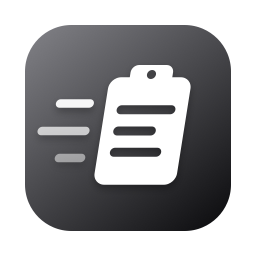

# Pace

<p align="center">
  
</p>

Pace is a private, local-first clipboard and snippet manager for macOS. It lives
in the menu bar, opens searchable clipboard history with `Hyper+C` and a
permanent snippet library with `Hyper+V`, then pastes the selected item straight
into the app you were using. Copied images are OCR'd locally so their text is
searchable and pasteable, and everything is encrypted at rest. A companion
`pace` CLI exposes clipboard history and snippets to scripts and agents.

## Features

- Captures text, rich text, URLs, files, and images with their native pasteboard representations
- Promotes useful clipboard entries into permanent, searchable snippets
- Expands snippet keywords while you type, with configurable trigger behavior and per-app exclusions
- Renders contextual snippet variables for dates, times, clipboard entries, UUIDs, cursor placement, and nested snippets
- Keyboard-first panel: type to search, `⏎` pastes, `⌘⏎` copies, `⇧⏎` pastes as plain text, `⌘⇧⏎` trims whitespace and pastes as one line, `⌥⏎` pastes OCR text, `⌘1`–`⌘9` paste visible rows, `⌘⌫` deletes, and `Esc` closes
- Configurable global and panel shortcuts, plus a detail pane with content previews and source metadata
- Automatic local OCR through Vision; recognized text participates in search
- Explicit OCR-text paste and copy actions for images; recognized terminals receive original image pastes through `Ctrl+V` for tools that support clipboard images, such as Claude Code
- AES-GCM encrypted item files and search catalog; the vault key lives in the login keychain
- Sensitive pasteboard markers and recognizable credentials (API keys for Anthropic, OpenAI, OpenRouter, and other model providers; GitHub, GitLab, Slack, Stripe, AWS, and Google tokens; JWTs; `.env`-style secrets; payment cards) are never stored
- Per-app capture exclusions in a plain-text `~/.config/pace/config.toml`
- Export history and snippets to JSON, optionally encrypted with a passphrase
- Configurable retention limits by age, item count, and storage size
- Pause capture for a fixed interval or until resumed
- Same-user CLI access over a private Unix socket; no token system
- Import your existing Alfred clipboard history with one script

## Download

Signed and notarized builds are published on the [GitHub Releases page](https://github.com/danielcorin/Pace/releases).

## Why

I wanted a fast, minimal clipboard history that keeps everything on my Mac —
no cloud sync, no account, no subscription — and that my scripts and coding
agents can read and write through a real CLI instead of UI automation.

## Using Pace

1. Launch Pace and grant Accessibility permission when prompted (required to paste directly into other apps).
2. Copy things. Pace captures them in the background.
3. Press `Hyper+C` (`⌃⌥⇧⌘C`) to open clipboard history over your current app, search or arrow to an item, and press `⏎` to paste it into the app you came from.

Double-clicking a row pastes it; right-clicking offers paste variants, copy,
and pin. Use `↑` and `↓` to move through history, `⌘↑` and `⌘↓` to jump
to either end, and `⌘1`–`⌘9` to paste the rows currently aligned with those
numbers. Press `⌘S` on a clipboard item to turn it into a snippet and open its
configuration in the snippet library. The global hotkeys and the paste,
plain-text, single-line, OCR, copy, save-as-snippet, and delete shortcuts are
configurable in Settings (`⌘,`). Settings also includes launch-at-login,
retention controls, and the CLI installer.

## Snippets

Press `Hyper+V` (`⌃⌥⇧⌘V`) to open the snippet library. Create a snippet from
scratch or promote a clipboard item, then give it an optional keyword such as
`;em`. With expansion enabled, typing that keyword in another app replaces it
with the rendered snippet. Settings controls immediate or delimiter-triggered
expansion, clipboard restoration, compatibility delay, and excluded apps.

Templates support contextual variables. The editor's **Insert Variable** menu
shows a live example beside each value.

```text
{date}                         current date
{time}                         current time
{datetime}                     current date and time
{datetime format=iso8601}      ISO 8601 with the local UTC offset
{clipboard}                    latest clipboard text
{clipboard offset=1}           previous clipboard text
{cursor}                       final cursor position
{uuid}                         a new UUID
{snippet name="Email"}         another snippet by name
```

Date variables also accept custom `DateFormatter` patterns, locales, and
offsets such as `{date format="yyyy-MM-dd" offset="+1d"}`. Append modifiers
with pipes, for example `{clipboard|trim|single-line}` or
`{snippet name="Email"|uppercase}`. Literal braces can be escaped as `{{` and
`}}`.

## The pace CLI

In the General settings tab, click **Install** beside **Command Line Tool** to
link the bundled CLI at `~/.local/bin/pace`. Run `pace help` for the complete
command reference.

```sh
pace status
pace show                      # open the history panel
pace list --limit 20
pace search 'invoice type:image app:Preview has:ocr'
pace add 'generated by a script' --source 'Build agent' --source-kind agent
pace copy ITEM_ID
pace paste ITEM_ID --ocr-text
pace get ITEM_ID --ocr-text
pace get ITEM_ID --output exported-item
pace pin ITEM_ID
pace delete ITEM_ID

pace show --mode snippets
pace snippets list
pace snippets search email
pace snippets get ';em'
pace snippets add 'Email' 'person@example.com' --keyword ';em'
pace snippets update ';em' --template 'new@example.com'
pace snippets render ';em'
pace snippets validate '{datetime format=iso8601}'
pace snippets copy ';em'
pace snippets paste ';em'
pace snippets promote CLIPBOARD_ITEM_ID --name 'Email' --keyword ';em' --expand

pace retention show
pace retention preview
pace retention set --days 30 --max-items 10000 --max-storage 1GB --prune

pace export --output ~/Backups/pace.json
pace export --output ~/Backups/pace-encrypted.json --encrypt
pace export decrypt ~/Backups/pace-encrypted.json --output pace.json

pace config show
pace config exclude com.apple.Terminal /Applications/Ghostty.app
pace config include com.apple.Terminal
```

The CLI launches the menu-bar service when needed, and the vault unlocks
automatically. Search supports `type:`, `app:`, `is:pinned`, and `has:ocr`
filters. Clipboard and snippet commands can return JSON. Snippets can be
addressed by full or unique-prefix UUID, exact keyword, or case-insensitive
name. Snippet templates may be positional, piped on stdin, or read with
`--template`/`--file`; render and validate resolve contextual variables using
the same live clipboard and snippet catalog as the app. `pace add` accepts text,
piped input, or a file, plus `--timestamp`, `--source-kind`, and `--session`
metadata so imports and agent workflows can preserve context.

### Configuration

`~/.config/pace/config.toml` (or `$XDG_CONFIG_HOME/pace/config.toml`) holds
settings meant for dotfiles and scripts. Edit it by hand, with `pace config`,
or from Settings; Pace re-reads it on the next copy.

```toml
# Bundle identifiers whose copies Pace never records.
excluded-apps = ["com.apple.Terminal", "com.mitchellh.ghostty"]
```

Unknown keys are rejected so typos don't pass silently. If the file becomes
invalid, Pace keeps using the last valid configuration and reports the error
in Settings.

### Exporting

`pace export` (or **Settings → General → Export…**) writes clipboard history
and snippets to one JSON file with mode 0600. Each clipboard entry carries a
`text` field with its plain or OCR text alongside the full item, whose binary
representations are base64. `--only clipboard|snippets` narrows the export and
`--force` replaces an existing file.

A plain export is not encrypted. `--encrypt` prompts for a passphrase (or reads
`PACE_EXPORT_PASSPHRASE`) and seals the JSON with AES-256-GCM using a
PBKDF2-HMAC-SHA256 key (600,000 iterations). The envelope is JSON that records
its parameters, and `pace export decrypt` restores the plain export.

### Importing from Alfred

```sh
scripts/import-alfred.sh
```

Imports Alfred's clipboard history — text and images, with original timestamps
and source apps. Entries pass through the normal capture path, so the
sensitive-content filter applies and duplicates merge. Raycast's history is
encrypted and cannot be imported.

## Requirements

- macOS 13 or later
- Xcode 16 or later (command-line tools) to build from source
- [mise](https://mise.jdx.dev/) for the pinned XcodeGen tool

## Build

The Xcode project is generated from `project.yml`; `*.xcodeproj` is not committed.

1. Clone the repository.
2. Copy `Configuration/Local.xcconfig.example` to `Configuration/Local.xcconfig`.
3. Set `DEVELOPMENT_TEAM` to your Apple Developer Team ID and choose a unique `PRODUCT_BUNDLE_IDENTIFIER`.
4. Generate and build:

```sh
mise trust
mise install
mise exec -- xcodegen generate
open Pace.xcodeproj    # or build from the command line:

xcodebuild \
  -project Pace.xcodeproj \
  -scheme Pace \
  -destination 'platform=macOS' \
  CODE_SIGNING_ALLOWED=NO \
  build

xcodebuild \
  -project Pace.xcodeproj \
  -scheme Pace \
  -destination 'platform=macOS' \
  CODE_SIGNING_ALLOWED=NO \
  test
```

The app build embeds the CLI at `Pace.app/Contents/Helpers/pace`.

The app icon and menu bar icon are drawn programmatically. After editing
`scripts/generate-icons.swift`, regenerate the PNGs in the asset catalog with:

```sh
swift scripts/generate-icons.swift
```

## Publishing a release

The release script reads the version, build number, bundle ID, and signing team
from the resolved Pace app target. Signing details come from the release
environment or the ignored `Configuration/Local.xcconfig`; no Apple
credentials are stored in the repository. The workflow follows
[Reco](https://github.com/danielcorin/Reco).

Copy the release environment template, fill in your Apple credentials and
GitHub repository, then trust the mise configuration once:

```sh
cp .env.example .env
$EDITOR .env
mise trust
```

`mise exec --` loads the ignored `.env` and redacts its values from mise
output. The file uses `APPLE_ID`, `APPLE_ID_PASSWORD`, `TEAM_ID`, and optionally
`DEVELOPER_ID_APPLICATION`. On the first release, the script validates those
values and stores the app-specific password in the `PaceNotary` Keychain
profile. Later releases reuse that profile.
`NOTARY_PROFILE` defaults to `PaceNotary`; the older `NOTARY_APPLE_ID`,
`DEVELOPER_IDENTITY`, and `DEVELOPMENT_TEAM` names remain supported. You can
also create the profile explicitly:

```sh
mise exec -- scripts/publish-release.sh --setup-notary-profile PaceNotary
```

Before a release, update `MARKETING_VERSION` and `CURRENT_PROJECT_VERSION` in
`project.yml`, regenerate the project, then commit and push those changes. Run:

```sh
mise exec -- scripts/publish-release.sh --dry-run    # inspect the release plan
mise exec -- scripts/publish-release.sh --publish    # build, notarize, and publish
```

The publish command requires a clean branch synchronized with its upstream. It
creates a universal archive, signs the app and embedded CLI with Developer ID,
submits the app directly with the configured `notarytool` profile, staples and
verifies it, creates ZIP and DMG artifacts, separately notarizes and staples
the outer DMG, verifies SHA-256 checksums, and uploads all three artifacts to a
GitHub Release. It then replaces `/Applications/Pace.app` with the verified app
and launches it. This flow does not require an Apple account to be logged into
Xcode.

Use `--skip-install` to leave the installed app untouched. Passing an existing
notarized `.app` path skips the archive and app-notarization stages.
`--skip-dmg-notarization` is an explicit exception for private testing and is
not recommended for public releases.

## Privacy and permissions

Everything stays on your Mac. History items and the search catalog are
encrypted with AES-GCM; the key is held in your login keychain, dropped from
memory while the Mac sleeps or the session locks, and reloaded automatically.
Pasteboard types that mark transient or secret content, and text matching
recognizable credential formats, are never stored, and apps listed in
`excluded-apps` are skipped entirely. Debug builds keep a separate
key and database under Pace's `Debug` support directory.

Pace is not sandboxed because it reads the general pasteboard and synthesizes
paste keystrokes; macOS Accessibility consent provides the user control for
that event posting. The CLI talks to the app over a mode-0600 Unix socket in
your home directory, so only your user can reach it. Pace makes no network
connections.

## AI disclosure

I made Pace using coding agent tools and LLMs.

## License

Licensed under the Apache License, Version 2.0. See [LICENSE](LICENSE).
